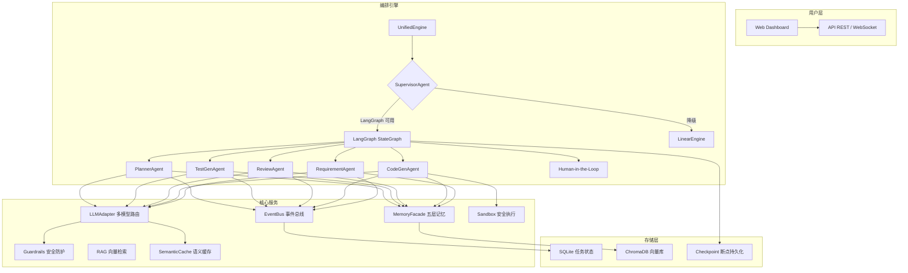

# NeuroForge V2 架构文档

> 版本: 2.0 | 更新日期: 2026-08-06

---

## 1. 系统总览

NeuroForge V2 是一个多智能体协同代码生成与审查系统。用户输入一句自然语言需求，系统调度五个专业化 AI 智能体由 Supervisor 编排器统一协调，输出生产就绪的代码与配套测试。

### 1.1 Supervisor 星型拓扑架构



### 1.2 核心模块关系 (ASCII)

```
┌─────────────────────────────────────────────────────────────────┐
│                        UnifiedEngine                           │
│  ┌─────────────────────────────────────────────────────────┐   │
│  │  SupervisorAgent ──► LangGraph StateGraph (主路径)       │   │
│  │                    └─► LinearEngine (降级兜底)          │   │
│  └─────────────────────────────────────────────────────────┘   │
│                                                                 │
│  ┌──────────┐ ┌──────────┐ ┌──────────┐ ┌──────────┐          │
│  │ Requirement│ │ CodeGen  │ │  Review  │ │ TestGen  │          │
│  │  Agent    │ │  Agent   │ │  Agent   │ │  Agent   │          │
│  └─────┬──────┘ └────┬──────┘ └────┬──────┘ └────┬──────┘   │
│        │              │              │              │           │
│  ┌─────▼──────────────▼──────────────▼──────────────▼──────┐   │
│  │              LLMAdapter (MultiModelRouter)              │   │
│  │  ┌──────────────┐  ┌──────────────┐  ┌─────────────┐  │   │
│  │  │  Main Model  │  │  Code Model  │  │ SemanticCache│  │   │
│  │  └──────────────┘  └──────────────┘  └─────────────┘  │   │
│  └─────────────────────────────────────────────────────────┘   │
│                                                                 │
│  ┌─────────────────────────────────────────────────────────┐   │
│  │ MemoryFacade (Working│Episodic│ShortTerm│Semantic│LongTerm)│
│  │  │ 语义记忆 → ChromaDB 向量检索（懒初始化）              │   │
│  │  │ 工作记忆 → LRU 容器                                  │   │
│  │  │ 短期记忆 → 滑动窗口 + Token 感知裁剪                 │   │
│  │  │ 情景记忆 → 事件时间线                                │   │
│  └─────────────────────────────────────────────────────────┘   │
└─────────────────────────────────────────────────────────────────┘
```

---

## 2. 组件架构

### 2.1 Agent 层

| 组件 | 职责 | 关键文件 |
|------|------|----------|
| **RequirementAgent** | 需求分析、结构化需求提取、技能匹配 | `app/agents/requirement_agent.py` |
| **CodeGenAgent** | 代码生成、ReAct 模式、验证自愈 | `app/agents/code_gen_agent.py` |
| **ReviewAgent** | 双层审查（AST + LLM）、评分、自动重试 | `app/agents/review_agent.py` |
| **TestGenAgent** | 测试用例生成、行为测试、执行验证 | `app/agents/test_gen_agent.py` |
| **PlannerAgent** | Plan-Execute-Reflect 复杂任务规划 | `app/agents/planner_agent.py` |
| **SupervisorAgent** | LLM 智能路由、自适应重试、降级兜底 | `app/agents/supervisor_agent.py` |

### 2.2 编排层

| 组件 | 职责 | 关键文件 |
|------|------|----------|
| **UnifiedEngine** | 统一入口（run / stream / resume） | `app/graph/unified_engine.py` |
| **Orchestrator** | DAG 任务编排、并行执行、恢复策略 | `app/graph/orchestrator.py` |
| **PipelineState** | 状态管理、Pydantic 数据模型 | `app/graph/state/models.py` |
| **LinearEngine** | 纯 Python 线性降级引擎 | `app/graph/pipeline.py` |

### 2.3 核心服务层

| 组件 | 职责 | 关键文件 |
|------|------|----------|
| **LLMAdapter** | 模型抽象、多模型路由、重试退避 | `app/core/llm_adapter.py` |
| **EventBus** | 事件驱动、发布订阅、线程安全 | `app/core/events.py` |
| **MemoryFacade** | 五层记忆统一入口 | `app/core/memory_system.py` |
| **Guardrails** | 输入注入检测 + 输出安全扫描 | `app/core/guardrails.py` |
| **SandboxExecutor** | 安全代码执行（Local / Docker） | `app/workspace/sandbox.py` |
| **SemanticCache** | 语义缓存（ChromaDB 向量匹配） | `app/core/semantic_cache.py` |
| **MetricsCollector** | 阶段级 Token、耗时、成功率追踪 | `app/core/observability.py` |
| **AuditLogger** | 审计日志（环形缓冲区 + SQLite 持久化） | `app/core/audit.py` |

### 2.4 基础设施层

| 组件 | 职责 | 关键文件 |
|------|------|----------|
| **SQLite Client** | 任务状态持久化 | `app/db/sqlite_client.py` |
| **ChromaDB** | 向量存储（RAG + 语义缓存） | `app/tools/rag_service.py` |
| **PluginManager** | 插件加载与管理 | `app/plugins/plugin_manager.py` |
| **ToolRegistry** | MCP 工具注册、权限、审计 | `app/tools/tool_registry.py` |
| **MCP Client/Server** | Model Context Protocol 双向工具协议 | `app/tools/mcp_client.py` / `app/tools/mcp_server.py` |

---

## 3. 事件驱动通信

### 3.1 EventBus 架构

NeuroForge V2 采用事件驱动架构（EDA），通过 `EventBus` 单例实现发布/订阅模式，解耦各组件间通信。

**核心事件类型：**

| 事件 | 触发时机 | 订阅者 |
|------|----------|--------|
| `TASK_STARTED` | 任务启动 | Dashboard、审计日志 |
| `NODE_COMPLETED` | 节点执行完成 | Dashboard、指标收集器 |
| `NODE_FAILED` | 节点执行失败 | Dashboard、告警管理器 |
| `HITL_WAITING` | 进入人工审批等待 | Dashboard、通知服务 |
| `HITL_APPROVED` | 人工审批通过 | 编排引擎、Dashboard |
| `HITL_REJECTED` | 人工审批被拒 | 编排引擎、Dashboard |
| `PIPELINE_DONE` | 流水线正常完成 | Dashboard、审计日志、记忆系统 |
| `PIPELINE_FAILED` | 流水线执行失败 | Dashboard、告警管理器、审计日志 |

**设计要点：**
- 线程安全：`threading.Lock` 保护订阅表和事件分发
- 异步友好：同步调用所有处理器，异常不影响其他处理器
- 生命周期覆盖：`TASK_STARTED → NODE_COMPLETED/NODE_FAILED → PIPELINE_DONE/PIPELINE_FAILED`

### 3.2 数据流

```
用户请求
    │
    ▼
┌─────────────┐    ┌─────────────┐    ┌─────────────┐
│  API 层     │───►│  Guardrails │───►│  Supervisor │
│ (REST/SSE)  │    │  注入防护   │    │  路由决策   │
└─────────────┘    └─────────────┘    └──────┬──────┘
                                              │
                    ┌─────────────────────────┼─────────────────────────┐
                    ▼         ▼         ▼         ▼         ▼         ▼
              Requirement  CodeGen   Review    TestGen   Planner   HITL
                    │         │         │         │         │         │
                    ▼         ▼         ▼         ▼         ▼         ▼
              ┌──────────────────────────────────────────────────────────┐
              │                    LLMAdapter                            │
              │  ┌──────────────┐  ┌──────────────┐  ┌──────────────┐  │
              │  │  Main Model  │  │  Code Model  │  │  DryRun 兜底  │  │
              │  └──────────────┘  └──────────────┘  └──────────────┘  │
              └──────────────┬──────────────────────────────────────────┘
                             │
           ┌─────────────────┼─────────────────┐
           ▼                 ▼                 ▼
    ┌─────────────┐   ┌─────────────┐   ┌─────────────┐
    │ MemoryFacade│   │  EventBus   │   │  Sandbox   │
    │ 五层记忆    │   │ 事件广播   │   │ 安全执行   │
    └──────┬──────┘   └──────┬──────┘   └──────┬──────┘
           │                 │                 │
           ▼                 ▼                 ▼
    ┌─────────────┐   ┌─────────────┐   ┌─────────────┐
    │  ChromaDB   │   │  SQLite DB  │   │  执行结果   │
    │  向量存储   │   │  状态持久化 │   │  （回写）   │
    └─────────────┘   └─────────────┘   └─────────────┘
```

---

## 4. 记忆架构

### 4.1 五层记忆体系

| 层级 | 类型 | 生命周期 | 存储 | 关键特性 |
|------|------|----------|------|----------|
| **WorkingMemory** | LRU 容器 | 任务级 | 内存 | 快速访问中间结果，LRU 淘汰（容量 200） |
| **ShortTermMemory** | 滑动窗口 | 会话级 | 内存 | 最近 50 条消息，Token 感知裁剪（8000 token 阈值），自动摘要 |
| **EpisodicMemory** | 事件时间线 | 会话级 | 内存 | 决策/工具调用/错误/洞察记录，支持 what_happened/why/outcome 元数据 |
| **SemanticMemory** | 向量语义 | 跨任务 | ChromaDB | RAG 向量检索，质量评分，懒初始化，降级为 SQLite 关键词检索 |
| **LongTermMemory** | 知识存储 | 持久 | ChromaDB | 封装语义记忆，标签管理，命中统计 |

### 4.2 懒初始化策略

SemanticMemory 采用懒初始化（Lazy Init）：
- 构造时不立即连接 ChromaDB
- 首次调用 `store_knowledge()` 或 `search()` 时才初始化 RAG 连接
- RAG 不可用时自动降级为 SQLite 关键词检索
- 启动时间从 ~3s 降至 <50ms

### 4.3 记忆巩固

`MemoryConsolidator` 周期性将短期记忆提升至长期存储：
- 触发条件：消息数 ≥ 20 或 Token ≥ 4000
- 生成摘要后存入 LongTermMemory
- 记录巩固事件到 EpisodicMemory

### 4.4 跨层搜索

`MemorySearcher` 统一在所有记忆层中检索：
- 短期记忆：关键词匹配 + 位置加权
- 长期记忆：向量语义检索
- 情景记忆：事件数据匹配
- 结果按相关性降序排列

---

## 5. 工具系统

### 5.1 ToolRegistry 架构

```
┌─────────────────────────────────────────────────────────────┐
│                       ToolRegistry                          │
│                                                             │
│  ┌─────────────────────────────────────────────────────┐   │
│  │ 权限管理层 (ToolPermissionLevel)                     │   │
│  │  FREE  <  OBSERVE  <  MODIFY  <  DANGEROUS          │   │
│  └─────────────────────────────────────────────────────┘   │
│                                                             │
│  ┌─────────────────────────────────────────────────────┐   │
│  │ 注册中心                                             │   │
│  │  • @register 装饰器自动发现                           │   │
│  │  • 动态参数提取与 Pydantic 模型生成                   │   │
│  │  • 结构化输出（OpenAI Function Calling 格式）          │   │
│  └─────────────────────────────────────────────────────┘   │
│                                                             │
│  ┌─────────────────────────────────────────────────────┐   │
│  │ 执行控制                                             │   │
│  │  • 权限检查 + 审批工作流                              │   │
│  │  • 参数校验（Pydantic）                              │   │
│  │  • 审计日志（ToolAudit）                             │   │
│  └─────────────────────────────────────────────────────┘   │
│                                                             │
│  ┌─────────────────────────────────────────────────────┐   │
│  │ 内置工具                                             │   │
│  │  • validate_code (FREE) — AST 安全校验                │   │
│  │  • read_file (OBSERVE) — 安全文件读取                │   │
│  │  • write_file (MODIFY) — 安全文件写入                │   │
│  │  • list_dir (OBSERVE) — 目录列表                     │   │
│  └─────────────────────────────────────────────────────┘   │
│                                                             │
│  ┌─────────────────────────────────────────────────────┐   │
│  │ MCP 集成                                             │   │
│  │  • MCPClient — 连接外部 MCP 工具服务器               │   │
│  │  • MCPServer — 暴露内置工具为 MCP 服务               │   │
│  │  • 双向协议，支持结构化工具描述                       │   │
│  └─────────────────────────────────────────────────────┘   │
└─────────────────────────────────────────────────────────────┘
```

### 5.2 权限级别

| 级别 | 权限 | 典型工具 | 说明 |
|------|------|----------|------|
| **FREE** | 无限制 | validate_code | 只读验证类，所有上下文可用 |
| **OBSERVE** | 只读 | read_file, list_dir | 可读取文件/目录，禁止写入 |
| **MODIFY** | 读写 | write_file | 可修改文件，需显式授权 |
| **DANGEROUS** | 高危 | exec_command | 需审批工作流，默认禁用 |

### 5.3 结构化输出

工具自动生成 Pydantic 参数模型和 OpenAI Function Calling 格式描述：
```python
@tool_registry.register(
    description="对 Python 代码做 AST 安全校验",
    permission_level=ToolPermissionLevel.FREE
)
def validate_code(source: str, allowed_modules: str = "") -> str:
    ...
```

---

## 6. 安全架构

### 6.1 输入防护 (InputGuardrail)

在用户输入进入 LLM 之前执行多维度注入检测：

| 检测类型 | 技术手段 | 覆盖范围 |
|----------|----------|----------|
| **Prompt Injection** | 正则模式 + 关键词密度（≥3 个注入关键词触发） | 忽略指令、角色伪装、分隔符绕过、Base64 编码 |
| **SQL Injection** | UNION/DROP/WAITFOR 等模式匹配 | SQL 语句注入 |
| **XSS Injection** | `<script>` / `javascript:` / `on事件` 等 | 跨站脚本 |
| **Command Injection** | `;` `|` `` ` `` 等命令拼接模式 | 命令注入 |
| **Path Traversal** | `../` / `file:///` 等路径穿越 | 路径穿越 |
| **LDAP Injection** | 特殊字符模式匹配 | LDAP 注入 |

### 6.2 输出防护 (OutputGuardrail)

LLM 输出返回给用户前执行敏感内容扫描：

| 检测类型 | 技术手段 | 处理方式 |
|----------|----------|----------|
| **API Key 泄露** | `sk-` / `api_key=` / `token=` 等模式 | 自动脱敏 `[REDACTED_API_KEY]` |
| **PII 泄露** | 邮箱/电话/信用卡/SSN/身份证/IP 模式 | 自动脱敏为 `[REDACTED_*]` |
| **文件路径泄露** | `/etc/passwd` / `~/.ssh/` 等模式 | 标记告警 |
| **代码执行指令** | `exec(` / `eval(` / `os.system(` 等 | 标记告警 |

### 6.3 完整安全扫描

`run_full_security_scan()` 提供一站式安全扫描：
1. 输入注入检测（正则 + 关键词密度 + 高级模式）
2. 输出敏感内容扫描（API Key + PII + 路径 + 执行指令）
3. 返回结构化 `SecurityFinding` 列表（严重级别、分类、描述、修复建议）

### 6.4 代码执行防护 (Sandbox)

```
执行前检查:
  ① AST 静态分析 — 禁止 Eval/Exec/Compile/Subprocess
  ② 模块白名单 — 仅允许 math/json/typing/collections 等
  ③ 资源限制 — 超时 30s、内存 512MB、输出 1MB 截断
  ④ 网络隔离 — 默认禁用网络
  ⑤ 文件系统 — 临时目录 + 自动清理
  ⑥ Docker 隔离 — 生产环境 --read-only + --network=none
```

### 6.5 OWASP LLM Top 10 覆盖

| 风险 | 防护状态 |
|------|----------|
| Prompt Injection | ✅ 多层正则 + 关键词密度 |
| Insecure Output Handling | ✅ 输出敏感内容扫描 |
| Sensitive Information Disclosure | ✅ API Key + PII 脱敏 |
| Supply Chain | ✅ AST 白名单校验 |
| Data Pollution | ✅ 记忆去重 + 质量评分 |

---

## 7. 可观测性

### 7.1 阶段级 Token 追踪

`_StageMetricsCollector` 按流水线阶段细分追踪 Token 用量：

| 阶段 | 追踪维度 |
|------|----------|
| requirement | prompt_tokens, completion_tokens, total_tokens, calls, cost, duration_ms |
| code_gen | 同上 |
| review | 同上 |
| test_gen | 同上 |
| 按模型 | by_model 分布 |
| 按 Agent | by_agent 分布 |

### 7.2 审计日志

`AuditLogger` 双持久化策略：

| 策略 | 实现 | 用途 |
|------|------|------|
| **环形缓冲区** | 内存中最多 1000 条，自动覆盖最旧记录 | 实时查询、Dashboard 展示 |
| **SQLite 持久化** | 写入 audit_log 表，支持全量查询 | 合规审计、历史追溯、BI 分析 |

**审计事件类型：**
- Agent 节点执行（开始/完成/失败）
- LLM 调用（模型、Token、耗时）
- 工具调用（工具名、参数、结果、审批状态）
- 状态转换（PipelineState 变更）
- 安全事件（注入检测、PII 脱敏）
- 人类交互（HITL 审批/拒绝）

### 7.3 告警管理

`AlertManager` 基于规则的告警：

| 规则 | 阈值 | 级别 |
|------|------|------|
| 工具调用错误率 > 30% | 0.3 | WARNING / CRITICAL |
| LLM 累计费用 > $10 | 10.0 | WARNING / CRITICAL |
| LLM 平均延迟 > 30s | 30.0 | WARNING / CRITICAL |

---

## 8. 多模型路由策略

### 8.1 任务驱动模型选择

```
┌─────────────────────────────────────────────────────────────┐
│                    MultiModelRouter                          │
│                                                             │
│  路由规则:                                                  │
│  ┌──────────────┬──────────────────┬────────────────────┐  │
│  │ 任务类型      │ 目标模型         │ 参数配置            │  │
│  ├──────────────┼──────────────────┼────────────────────┤  │
│  │ code_gen      │ code_model      │ temp=0.2, max=8192 │  │
│  │ test_gen      │ code_model      │ temp=0.2, max=8192 │  │
│  │ review        │ main_model      │ temp=0.7, max=4096 │  │
│  │ chat          │ main_model      │ temp=0.7, max=4096 │  │
│  │ requirement   │ main_model      │ temp=0.7, max=4096 │  │
│  └──────────────┴──────────────────┴────────────────────┘  │
│                                                             │
│  降级策略: code_model 失败 → 自动 fallback 到 main_model     │
│  配置: 独立 API Key + Base URL（双模型配置）                 │
└─────────────────────────────────────────────────────────────┘
```

### 8.2 成本优化

| 场景 | 模型选择 | 理由 |
|------|----------|------|
| 代码生成（高强度） | 专用代码模型 | 代码模型在生成质量上优于通用模型 |
| 代码审查（轻量） | 通用模型 | 审查任务需要语义理解，Token 量小 |
| 需求分析（对话） | 通用模型 | 需要自然语言交互能力 |
| 测试生成（代码） | 专用代码模型 | 生成结构化测试代码 |

---

## 9. V1 vs V2 对比

| 维度 | V1 | V2 |
|------|----|----|
| **编排模式** | 线性流水线（固定顺序） | Supervisor 星型拓扑（LLM 动态路由） |
| **Agent 数量** | 4 个（Requirement / CodeGen / Review / Test） | 6 个（+ Planner + Supervisor） |
| **通信方式** | 直接方法调用 | EventBus 事件驱动 |
| **记忆体系** | 单段会话记忆 | 五层记忆（Working / ShortTerm / Episodic / Semantic / LongTerm） |
| **模型路由** | 单一模型 | 多模型路由（任务驱动选择） |
| **安全防护** | 基础输入校验 | 输入+输出双防护 + 完整安全扫描管线 |
| **可观测性** | 基础日志 | 阶段级 Token 追踪 + 双持久化审计 + 告警 |
| **降级策略** | 无 | LangGraph → LinearEngine → DryRun 三级降级 |
| **复杂任务** | 不支持 | PlannerAgent + Plan-Execute-Reflect 循环 |
| **工具系统** | 内置工具 | 注册制 + 权限分级 + MCP 集成 |
| **启动速度** | ~3s（ChromaDB 同步初始化） | <50ms（懒初始化） |
| **断点续跑** | 不支持 | SqliteSaver + Checkpoint 持久化 |
| **代码行数** | ~8000 行 | ~12000 行 |

---

## 10. 设计决策与权衡

| 决策 | 选择 | 权衡 |
|------|------|------|
| **LangGraph vs 自研编排** | LangGraph + LinearEngine 兜底 | 引入依赖但获得状态管理和 checkpoint |
| **EventBus vs 直接调用** | EventBus 发布/订阅 | 增加异步复杂性但大幅提升可维护性 |
| **单进程 vs 多进程** | 单进程 + 线程锁 | 简化部署但限制了水平扩展 |
| **SQLite vs 外部 DB** | SQLite 优先 | 零运维但单文件限制并发写入 |
| **ChromaDB 懒初始化** | 懒加载 | 启动快但首次使用有延迟 |
| **规则路由 vs LLM 路由** | 规则兜底 + LLM 决策 | 双保险但增加了代码复杂度 |
| **审计双持久化** | 内存环形缓冲 + SQLite | 查询快但实现复杂 |
| **MCP 协议集成** | 原生支持 | 生态开放但增加了攻击面 |
| **Token 感知窗口 vs 固定窗口** | Token 感知 | 更精确但需要估算 Token 数 |

---

## 11. 技术栈

| 依赖 | 版本 | 用途 |
|------|------|------|
| Python | ≥ 3.10 | 运行时 |
| FastAPI | 0.115.6 | 异步 Web 框架 |
| Uvicorn | 0.34.0 | ASGI 服务器 |
| LangGraph | ≥ 0.2.x | 编排引擎（可选） |
| LangChain Core | ≥ 0.3.x | LLM 抽象层 |
| Pydantic | ≥ 2.x | 数据模型校验 |
| Pydantic Settings | ≥ 2.x | 配置管理 |
| ChromaDB | ≥ 0.5.x | 向量存储 |
| Tenacity | ≥ 9.x | 重试退避 |
| HTTPX | ≥ 0.27.x | HTTP 客户端 |
| SQLite3 | 标准库 | 状态持久化 |
| SQLAlchemy | 2.0.36 | ORM（可选） |
| Three.js | — | 3D 可视化 |
| Docker | — | 生产沙箱隔离 |

---

## 12. 扩展性设计

### 12.1 新 Agent 类型
实现 `agent_node(state) -> dict` → 注册到 LangGraph/LinearEngine

### 12.2 新路由规则
继承 `SupervisorAgent` → 覆盖 `_rule_decide` 方法

### 12.3 新记忆层
继承 `MemoryFacade` → 增加 `read/write` 的 level 支持

### 12.4 新安全策略
扩展 `InputGuardrail` 正则 → 添加自定义注入检测模式

### 12.5 新执行模式
实现 `SandboxExecutor` 子类 → 支持 K8s/FaaS 等执行后端

### 12.6 新 LLM 厂商
实现 `_resolve_provider` → 动态解析 Base URL 和 API Key

### 12.7 水平扩展
- 无状态设计：状态持久化在 SQLite/Checkpoint
- EventBus 可替换为 Redis Pub/Sub 或 Kafka
- 可通过消息队列分发任务到多 Worker 实例

---

*本文档基于 NeuroForge V2 源码逆向分析生成，如有更新请同步修改。*